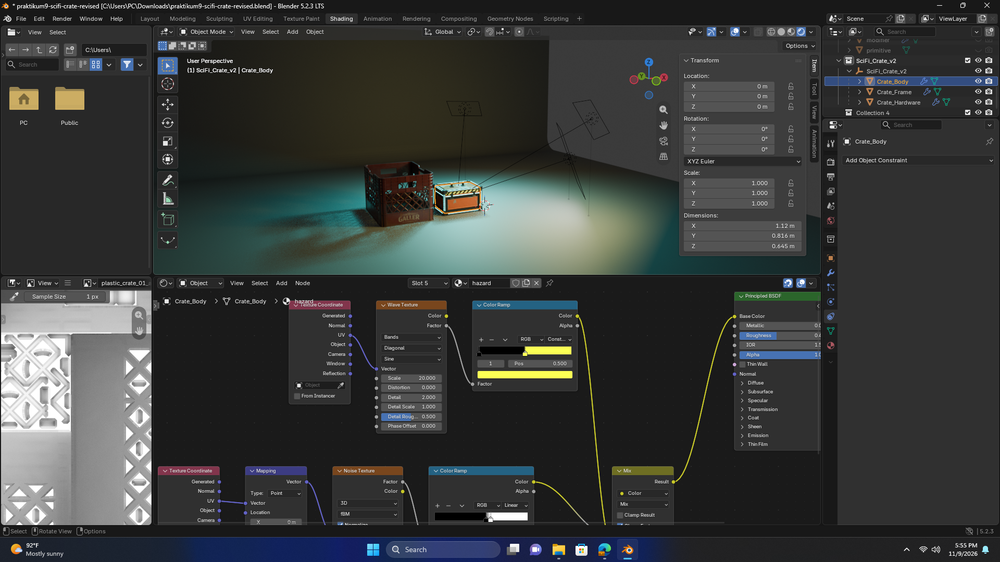
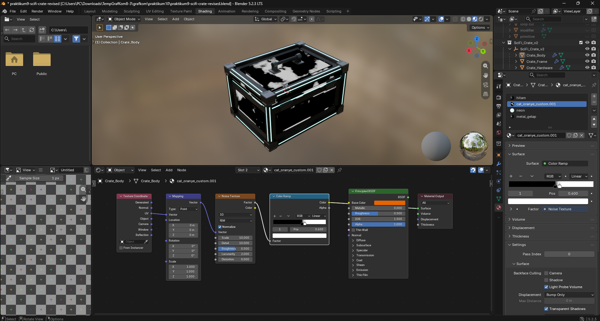
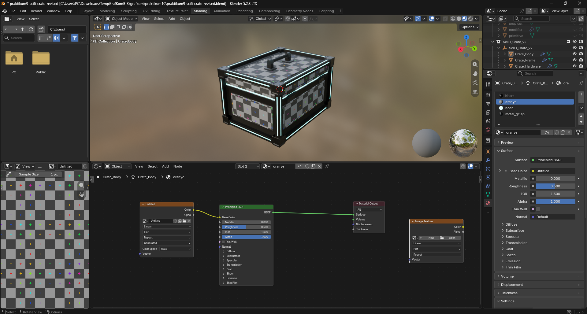
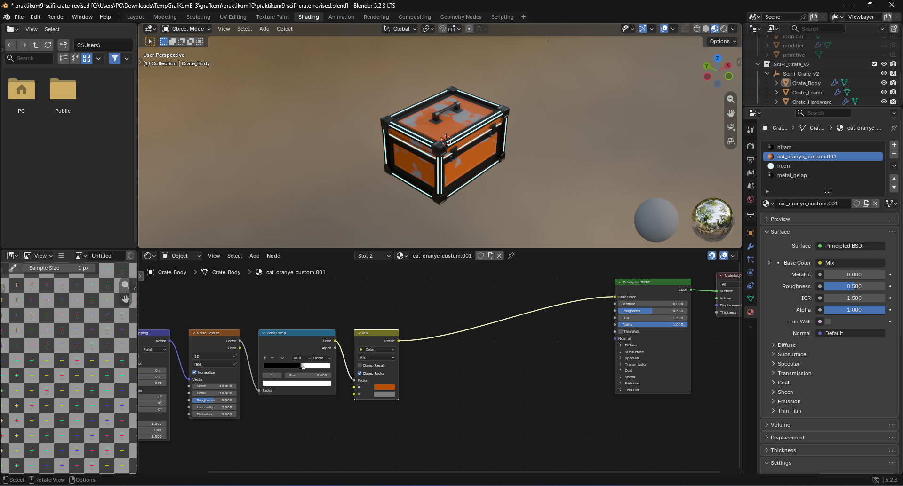
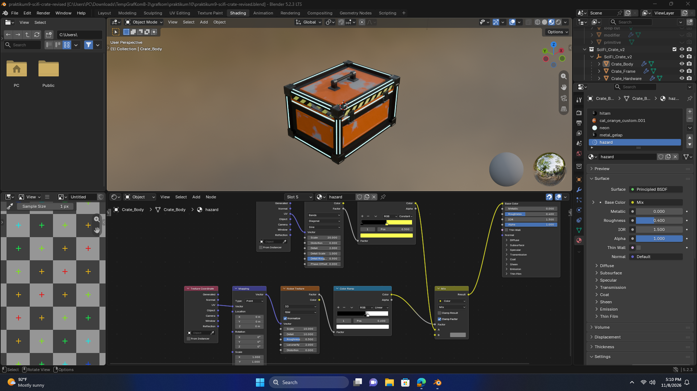

# Praktikum 10 – Scene 3D Sci-Fi Crate

## Identitas

| Nama | NRP |
| --- | --- |
| Nyoman Surya Hutama Andyartha | 5025241093 |
| Willy Dava Nugraha | 5025241090 |

Tugas Grafika Komputer: membuat **scene 3D lengkap** di Blender yang menggabungkan modeling, UV mapping, texturing, lighting, kamera, dan rendering. Scene ini memadukan **crate sci-fi hasil modeling sendiri** (lanjutan Praktikum 9) dengan **model eksternal ber-PBR lengkap** (Plastic Crate 01 dari Poly Haven).



---

## Spesifikasi

| Item | Keterangan |
|---|---|
| Software | Blender 5.2.3 LTS |
| Render engine | Eevee (Raytracing aktif) |
| Resolusi | 1920 × 1080 |
| Color management | AgX |
| File utama | `praktikum9-scifi-crate-revised.blend` |

## Struktur folder

```
praktikum10/
├── praktikum9-scifi-crate-revised.blend   # file scene utama
├── README.md
└── screenshots/
    ├── Final.png            # tampilan scene akhir
    ├── TextureMapping.png   # pengecekan UV dengan UV Grid
    ├── UVMapping.png        # pola tekstur prosedural (Noise + Color Ramp)
    ├── BumpMap.png          # material cat oranye lengkap (warna, roughness, bump)
    └── HazardDetail.png     # material hazard kuning-hitam
```

## Struktur scene (Outliner)

| Collection | Isi |
|---|---|
| `SciFi_Crate_v2` | Empty `SciFi_Crate_v2` (induk, skala 0.3) dengan anak `Crate_Body`, `Crate_Frame`, `Crate_Hardware` |
| `Collection` | `plastic_crate_01`, `Lantai_Backdrop`, `Key_light`, `Fill_light`, `Rim_light`, `Camera` |
| `Praktikum9_Progres (lama)` | Tahap modeling Praktikum 9 (`awal` → `primitive` → `inset extrude` → `loop cut` → `modifier` → `final asset`). Disembunyikan dan tidak ikut render, disimpan sebagai dokumentasi proses |

---

## 1. Model buatan sendiri: Sci-Fi Crate

### Modeling
Crate dikembangkan dari hasil Praktikum 9 dan dibagi menjadi tiga objek berdasarkan fungsinya:

| Objek | Isi | Teknik |
|---|---|---|
| `Crate_Body` | Badan bawah, tutup, cincin neon di sambungan tutup | Box, *inset* bertingkat untuk panel cekung, pelat timbul, dan alur panel |
| `Crate_Frame` | 12 rangka tepi dengan alur neon, 8 blok sudut logam, 4 kaki karet | Box + inset untuk alur neon dan detail blok sudut |
| `Crate_Hardware` | Engsel belakang, kunci (latch) depan, gagang atas, baut | Beberapa *loose part* (box & cylinder) dalam satu mesh |

- Ketiga objek di-*parent* ke Empty `SciFi_Crate_v2`, sehingga seluruh crate dapat dipindah, diputar, dan diskalakan sekaligus.
- Setiap objek memakai **Bevel modifier** (limit angle 30°, *harden normals*) agar tepi terlihat halus dan menangkap cahaya.
- Ukuran akhir crate sekitar **1.21 × 0.91 × 0.74 m**.

### UV Mapping
`Crate_Body` di-*unwrap*, lalu hasilnya dicek dengan tekstur **UV Grid**. Kotak-kotak terlihat persegi dan tidak melar di seluruh permukaan.



### Material & tekstur buatan sendiri
Semua tekstur dibuat secara **prosedural** dengan node dan memakai koordinat **UV** dari hasil unwrap.

**`cat_oranye_custom.001`: cat oranye usang**

```
Texture Coordinate (UV) → Mapping → Noise Texture → Color Ramp ─┬→ Mix Color (Factor) → Base Color
                                                                └→ Map Range        → Roughness
                                    Noise Texture ─────────────────→ Bump           → Normal
```

| Node | Pengaturan | Fungsi |
|---|---|---|
| Noise Texture | Scale 10, Detail 10 | Pola dasar bercak |
| Color Ramp | stop 0.55 (hitam) – 0.60 (putih) | Menajamkan pola menjadi bercak cat terkelupas |
| Mix Color | A = oranye, B = abu logam | Warna cat dan logam di bawahnya |
| Map Range | To Min 0.35, To Max 0.8 | Cat lebih licin, bagian terkelupas lebih kasar |
| Bump | Strength ≈ 0.19, Distance 0.1 | Permukaan cat sedikit tidak rata |





**`hazard`: garis peringatan kuning-hitam** (di panel sisi tutup)

| Node | Pengaturan |
|---|---|
| Wave Texture | Bands, Diagonal, Sine, Scale 20 |
| Color Ramp | Interpolasi *Constant*: hitam (0.0) – kuning (0.5) |
| Noise + Color Ramp | Pola terkelupas yang sama dengan cat oranye |
| Mix Color | Garis hazard dicampur dengan abu logam agar ikut terlihat usang |



**Material pendukung**

| Material | Pengaturan |
|---|---|
| `hitam` | Base Color hitam, Roughness 0.5 (rangka) |
| `neon` | Emission cyan, Strength 8 (strip cahaya) |
| `metal_gelap` | Metallic 1.0, Roughness 0.35 (blok sudut, baut, engsel) |

---

## 2. Model eksternal dengan PBR: Plastic Crate 01

- **Sumber:** [Poly Haven – Plastic Crate 01](https://polyhaven.com/a/plastic_crate_01), resolusi 2K
- **Lisensi:** CC0 (domain publik)

| Map | File | Color Space | Disambungkan ke |
|---|---|---|---|
| Base Color / Albedo | `plastic_crate_01_diff` | sRGB | Mix (Multiply) A → Base Color |
| Ambient Occlusion | `plastic_crate_01_ao_2k` | Non-Color | Mix (Multiply) B, Factor 1 |
| Roughness | `plastic_crate_01_rough` | Non-Color | Roughness |
| Metallic | `plastic_crate_01_metal` | Non-Color | Metallic |
| Normal (OpenGL) | `plastic_crate_01_nor_gl` | Non-Color | Normal Map (Tangent) → Normal |
| Emission | – | – | Tidak tersedia pada asset ini |

- Principled BSDF tidak memiliki input AO, sehingga AO **dikalikan** dengan Base Color melalui node Mix (Multiply).
- Map metallic bernilai gelap karena plastik bukan logam.

---

## 3. Komposisi scene

- **Fokus visual:** crate sci-fi. Warna oranye dan strip neon cyan menjadi titik perhatian utama.
- **Pendukung:** plastic crate diletakkan di samping crate sci-fi sebagai pembanding material (plastik vs. cat logam).
- **Ground/latar:** `Lantai_Backdrop`, yaitu plane yang rusuk belakangnya diekstrusi menjadi dinding dengan sudut melengkung, sehingga latar mulus tanpa garis cakrawala. Material `Lantai` abu gelap, Roughness ≈ 0.6.

## 4. Lighting

Three-point lighting dengan Area light. Ketiganya memakai constraint **Track To** sehingga selalu mengarah ke crate.

| Lampu | Fungsi | Power | Warna | Size |
|---|---|---|---|---|
| `Key_light` | Cahaya utama, depan-samping atas | 300 W | Kuning hangat | 1.5 m |
| `Fill_light` | Melembutkan bayangan dari sisi berlawanan | 100 W | Putih | 2 m |
| `Rim_light` | Memisahkan tepi objek dari latar, dari belakang atas | 500 W | Cyan (senada neon) | 1 m |

Strip neon (Emission) juga menjadi sumber cahaya tambahan pada scene.

## 5. Kamera

| Pengaturan | Nilai |
|---|---|
| Focal length | 50 mm |
| Resolusi | 1920 × 1080 |
| Komposisi | Crate sci-fi sebagai fokus, sudut pandang tiga perempat dari atas |

## 6. Rendering

- Engine **Eevee** dengan Raytracing aktif.
- Color management **AgX**.
- Compositor: node **Glare (Fog Glow)** untuk efek pendar pada neon.

---

## Cara membuka

1. Buka `praktikum9-scifi-crate-revised.blend` dengan **Blender 5.2** atau lebih baru.
2. Tekan **Numpad 0** untuk melihat dari kamera, lalu **Z → Rendered** untuk pratinjau.
3. Tekan **F12** untuk render final.
4. Tahap modeling Praktikum 9 dapat ditampilkan dengan menyalakan ikon mata pada collection `Praktikum9_Progres (lama)`.

## Kredit

- **Sci-Fi Crate:** hasil modeling, UV, dan material sendiri.
- **Plastic Crate 01:** [Poly Haven](https://polyhaven.com/a/plastic_crate_01), lisensi CC0.
