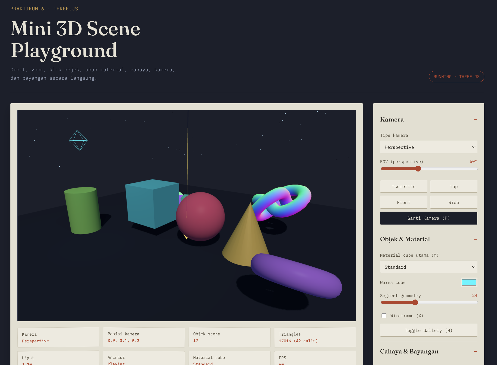

# Praktikum 06 — Three.js Mini 3D Scene Playground

## Identitas

| Nama | NRP |
| --- | --- |
| Nyoman Surya Hutama Andyartha | 5025241093 |
| Willy Dava Nugraha | 5025241090 |

# Deskripsi

Scene 3D interaktif berbasis **Three.js** (`0.185.1`) untuk mempelajari **scene graph, kamera, material, cahaya, bayangan, dan animasi**. Berbeda dengan praktikum sebelumnya yang memakai WebGL2 murni, di sini shader, buffer, dan matriks sudah dibungkus oleh library, sehingga fokus bergeser ke **menyusun scene** dan mengamati efek tiap parameter secara real-time.

Scene berisi cube utama, sphere, cone, cylinder, torus, torus knot, ground, bintang, dan *material gallery*. Objek dianimasikan dengan `THREE.Clock` + delta time, diterangi `AmbientLight`, `DirectionalLight`, dan `PointLight`, serta menghasilkan **shadow** di atas ground. Kamera dinavigasi dengan `OrbitControls` dan dapat berpindah antara **Perspective** dan **Orthographic**.

## Tujuan Pembelajaran

- Memahami komponen minimum Three.js: **Scene, Camera, Renderer**, dan **Mesh** (Geometry + Material).
- Membedakan karakter material: **Basic, Normal, Lambert, Phong, Standard**.
- Memahami tiga jenis cahaya dan **rantai konfigurasi shadow**.
- Membandingkan **PerspectiveCamera** dan **OrthographicCamera**.
- Memakai **delta time** agar animasi konsisten di berbagai refresh rate.
- Memakai **Raycaster** untuk memilih objek lewat klik mouse.
- Membaca informasi performa lewat `renderer.info` (triangle, draw call) dan FPS.

---

## 1. Struktur File

| File | Isi |
|---|---|
| `index.html` | Kerangka halaman: container scene, HUD, panel kontrol, **import map** Three.js |
| `style.css` | Layout responsif dan styling panel (tema gelap) |
| `main.js` | Scene, camera, renderer, geometry, material, light, shadow, picking, input, dan animation loop |
| `README.md` | Dokumentasi |

Three.js dan `OrbitControls` dimuat dari jsDelivr lewat import map:

```html
<script type="importmap">
  { "imports": {
    "three": "https://cdn.jsdelivr.net/npm/three@0.185.1/build/three.module.js",
    "three/addons/": "https://cdn.jsdelivr.net/npm/three@0.185.1/examples/jsm/"
  } }
</script>
<script type="module" src="main.js"></script>
```

Karena memakai **ES module**, halaman harus dibuka lewat server HTTP, bukan `file://`.

---

## 2. Konsep Dasar

### Scene, Camera, Renderer

```js
const scene = new THREE.Scene();
const camera = new THREE.PerspectiveCamera(50, aspect, 0.1, 100);
const renderer = new THREE.WebGLRenderer({ antialias: true });
renderer.render(scene, camera);
```

- **Scene** — wadah semua objek, cahaya, dan background.
- **Camera** — sudut pandang. Posisi awal `(4.8, 3.6, 6.5)` menghadap target `(0, 0.8, 0)`.
- **Renderer** — menggambar scene ke `<canvas>`. Pixel ratio dibatasi maksimal 2 agar layar retina tidak membebani GPU.

### Mesh = Geometry + Material

Setiap objek terdiri dari **bentuk** (geometry) dan **tampilan permukaan** (material). Posisi, rotasi, dan skala disimpan di `mesh.position`, `mesh.rotation`, dan `mesh.scale`, lalu Three.js yang menyusun matriks modelnya.

### Daftar Objek

| Objek | Geometry | Material | Gerakan |
|---|---|---|---|
| Cube utama | `BoxGeometry` | Standard (bisa diganti) | Dikendalikan keyboard |
| Sphere | `SphereGeometry` | Phong | Berputar dan naik-turun (`Math.sin`) |
| Cone | `ConeGeometry` | Standard | Berputar |
| Cylinder | `CylinderGeometry` | Lambert | Berputar |
| Torus | `TorusGeometry` | Phong | Berputar sumbu Z |
| Torus Knot | `TorusKnotGeometry` | Normal | Berputar sumbu X dan Y |
| Ground | `PlaneGeometry` 14×14 | Lambert | Diam (penerima shadow) |
| Gallery (4 cube) | `BoxGeometry` | Basic, Normal, Lambert, Phong | Berputar dengan kecepatan berbeda |
| Bintang | `Points` (500 titik) | `PointsMaterial` | Berputar pelan |

> `PlaneGeometry` secara default berdiri di bidang XY, sehingga ground harus diputar `rotation.x = -Math.PI / 2` agar menjadi lantai.

---

## 3. Material

| Material | Butuh light? | Karakter |
|---|---|---|
| `MeshBasicMaterial` | Tidak | Warna datar, tidak terpengaruh cahaya |
| `MeshNormalMaterial` | Tidak | Warna dari arah normal permukaan (berguna untuk debugging) |
| `MeshLambertMaterial` | Ya | Diffuse saja, tanpa highlight (murah) |
| `MeshPhongMaterial` | Ya | Diffuse + specular highlight (`shininess`) |
| `MeshStandardMaterial` | Ya | Berbasis fisik (PBR): `roughness` dan `metalness` |

**Material Gallery** menampilkan empat cube yang geometry-nya sama persis (Basic, Normal, Lambert, Phong) berjajar, sehingga perbedaan material terlihat langsung. Material cube utama juga dapat diganti lewat dropdown atau tombol `M`, dan warnanya bisa diubah lewat color picker.

---

## 4. Cahaya dan Bayangan

### Jenis Cahaya

| Light | Fungsi |
|---|---|
| `AmbientLight` | Pencahayaan dasar tanpa arah, supaya sisi gelap tidak hitam pekat |
| `DirectionalLight` | Sumber utama (seperti matahari), arah sejajar, intensitas diatur slider, `castShadow` aktif |
| `PointLight` | Cahaya cyan ke segala arah dengan jarak jangkau 12, `castShadow` aktif, intensitas dan warna dapat diubah |

**Light Orbit** (`L`) menggerakkan `DirectionalLight` melingkar dengan `cos`/`sin`, ditambah marker dan helper panah arah agar pergerakan sumber cahaya mudah diamati. **Light helper** dapat dimatikan lewat checkbox.

### Rantai Konfigurasi Shadow

Shadow baru muncul jika **seluruh rantai** ini terpenuhi:

```js
renderer.shadowMap.enabled = true;   // 1. renderer
directionalLight.castShadow = true;  // 2. light
mesh.castShadow = true;              // 3. objek pembuat bayangan
ground.receiveShadow = true;         // 4. objek penerima bayangan
```

Konfigurasi lain:

- `renderer.shadowMap.type = THREE.PCFSoftShadowMap` — tepi shadow lebih halus.
- Shadow camera `DirectionalLight`: `left/right/top/bottom = ±7`, `near = 0.1`, `far = 20`. Jika objek berada di luar kotak ini, bayangannya terpotong.
- **Kualitas shadow** dapat diganti **512 / 1024 / 2048 / 4096**. Saat diganti, shadow map lama di-`dispose()` dan di-set `null` agar dibuat ulang dengan resolusi baru.

---

## 5. Kamera

### Perspective vs Orthographic

| | PerspectiveCamera | OrthographicCamera |
|---|---|---|
| Efek | Objek jauh tampak lebih kecil | Ukuran objek sama di semua kedalaman |
| Parameter | `fov`, `aspect`, `near`, `far` | `left`, `right`, `top`, `bottom` |
| Slider FOV | Berpengaruh (20°–100°) | Tidak berpengaruh |

Saat berpindah kamera (`P` / `C` / dropdown), posisi dan target orbit **dipertahankan** sehingga pandangan tidak melompat. `OrbitControls` dibuat ulang untuk kamera yang aktif.

### Responsif

Ketika ukuran jendela berubah, `aspect` kamera perspective dan batas `left/right` kamera orthographic dihitung ulang, lalu `updateProjectionMatrix()` dipanggil. Tanpa langkah ini gambar akan terdistorsi.

### Preset Tampilan

Tombol **Isometric / Top / Front / Side** memindahkan kamera ke posisi tetap dengan target kembali ke `(0, 0.8, 0)`.

### OrbitControls

| Aksi | Hasil |
|---|---|
| Drag kiri | Orbit |
| Scroll | Zoom |
| Drag kanan | Pan |

Parameter yang bisa diatur lewat panel: enable, pan, damping, damping factor, rotate speed, dan zoom speed. Tombol **Reset** mengembalikan semuanya ke nilai awal.

`camera.lookAt()` tidak dipanggil tiap frame karena arah pandang sudah dikelola oleh `controls.target`.

---

## 6. Animasi dan Input

### Loop Animasi

```js
const rawDelta = clock.getDelta();
const dt = Math.min(rawDelta, 0.05);
state.time += dt * state.speed;
updateScene(dt, dt * state.speed);
```

Gerakan dihitung dengan **delta time**, sehingga kecepatan sama di monitor 60 Hz maupun 144 Hz. `Math.min(..., 0.05)` mencegah lompatan besar saat tab sempat tidak aktif. Ada dua nilai waktu:

- `dt` — waktu nyata, untuk input keyboard (tetap responsif walau animasi di-pause).
- `sdt` — `dt × kecepatan`, untuk animasi otomatis (ikut slider kecepatan dan pause).

### Kontrol Cube (State-based Input)

`keydown` menandai `keys[key] = true`, `keyup` mengembalikannya ke `false`, dan posisi dihitung tiap frame selama tombol ditahan (kecepatan gerak 2.2 unit/detik, rotasi 1.8 rad/detik). Posisi dibatasi (`clamp`) agar cube tidak keluar dari ground. Aksi sekali-tekan seperti pause dan ganti kamera memakai `event.repeat` agar tidak terpicu berulang saat tombol ditahan. State `keys` juga dibersihkan saat jendela kehilangan fokus supaya tidak ada tombol "tersangkut".

### Picking dengan Raycaster

Klik pada objek memilihnya, ditandai dengan `BoxHelper`, dan namanya tampil di HUD. Koordinat mouse diubah menjadi **Normalized Device Coordinates** (−1…1):

```js
pointer.set(
  ((e.clientX - rect.left) / rect.width) * 2 - 1,
  -((e.clientY - rect.top) / rect.height) * 2 + 1   // sumbu Y dibalik
);
raycaster.setFromCamera(pointer, activeCamera);
```

Klik hanya dihitung jika pergeseran mouse kurang dari 5 piksel, supaya **drag untuk orbit tidak ikut memilih objek**. **Klik ganda** memfokuskan orbit ke objek tersebut.

---

## 7. Tampilan Tambahan

| Fitur | Keterangan |
|---|---|
| Wireframe (`X`) | Menampilkan kerangka segitiga pada semua material |
| Segment geometry | Slider 3–64 untuk jumlah segmen sphere, cone, cylinder, torus; geometry lama di-`dispose()` |
| Tone mapping | None, ACES Filmic, Reinhard, AgX |
| Grid & axes (`I`) | `GridHelper` dan `AxesHelper` sebagai referensi spasial |
| Fog (`F`) | `THREE.Fog` dari jarak 8 sampai 22 |
| Bintang (`T`) | 500 titik acak pada belahan atas langit |
| Kecepatan animasi | Slider 0×–3× |
| Screenshot (`K`) | Menyimpan canvas sebagai PNG |

---

## 8. HUD (Scene Information)

| Kartu | Isi |
|---|---|
| Kamera | Perspective / Orthographic |
| Posisi kamera | `x, y, z` kamera aktif |
| Objek scene | Jumlah child langsung di `scene` |
| Triangles | Jumlah triangle dan draw call dari `renderer.info` |
| Light | Intensitas DirectionalLight |
| Animasi | Playing / Paused |
| Material cube | Material yang sedang dipakai cube utama |
| FPS | Dihitung ulang tiap 0,5 detik |
| Objek terpilih | Nama dan posisi dunia objek yang diklik |

---

## 9. Challenge yang Dikerjakan (A–H)

| Challenge | Implementasi |
|---|---|
| **A** Tambah Geometry | Cone, Cylinder, Torus, dan Torus Knot, masing-masing punya material, transform, dan posisi yang tidak bertabrakan |
| **B** Material Gallery | 4 cube sama (Basic, Normal, Lambert, Phong) berjajar; `H` untuk show/hide; material cube utama bisa diganti dengan `M` |
| **C** OrthographicCamera | `P` / `C` / dropdown berpindah Perspective ↔ Orthographic; posisi dan target dipertahankan; projection ikut resize |
| **D** Light Animation | `L` menggerakkan DirectionalLight melingkar dengan marker dan helper arah |
| **E** Shadow Quality | Dropdown 512 / 1024 / 2048 / 4096; shadow map lama di-dispose |
| **F** Scene Information | HUD posisi kamera, jumlah objek, triangle dan draw call, FPS, material aktif, intensitas light, status animasi |
| **G** Toggle Animation | `Space` / `G` pause/resume, sekali per penekanan |
| **H** Continuous Control | Arrow/WASD memindahkan cube, `Q`/`E` memutar cube, memakai delta time dan state `keys` |

---

## 10. Kontrol

### Keyboard

| Tombol | Fungsi |
|---|---|
| `↑ ↓ ← →` / `W A S D` | Gerakkan cube utama |
| `Q` / `E` | Putar cube utama |
| `P` / `C` | Perspective ↔ Orthographic |
| `Space` / `G` | Pause / resume animasi |
| `L` | Light orbit |
| `H` | Tampilkan / sembunyikan material gallery |
| `M` | Ganti material cube utama |
| `X` | Wireframe on/off |
| `I` | Grid & axes on/off |
| `F` | Fog on/off |
| `T` | Bintang on/off |
| `K` | Simpan screenshot |
| `R` | Reset scene, kamera, dan parameter OrbitControls |

> Shortcut keyboard tidak aktif saat fokus berada pada elemen `<select>`, sehingga panah tetap bisa dipakai untuk memilih opsi dropdown.

### Mouse

| Input | Fungsi |
|---|---|
| Drag kiri / scroll / drag kanan | Orbit / zoom / pan |
| Klik objek | Pilih objek dan tampilkan info di HUD |
| Klik ganda objek | Fokuskan kamera ke objek |

### Panel Kontrol

Panel kanan dikelompokkan menjadi **Kamera**, **Objek & Material**, **Cahaya & Bayangan**, **Tampilan**, **Animasi**, dan **OrbitControls**. Setiap perubahan lewat keyboard disinkronkan ke slider, checkbox, dan dropdown, begitu pula sebaliknya.

---

## 11. Cara Menjalankan

Buka `index.html` melalui server HTTP lokal, misalnya **Live Server** di VS Code, atau:

```bash
npx serve .
# atau
python -m http.server 8000
# lalu buka http://localhost:8000
```

Jangan membuka lewat `file://` karena memakai ES module. Koneksi internet dibutuhkan karena Three.js dimuat dari jsDelivr. Gunakan browser modern yang mendukung WebGL2 (Chrome, Edge, Firefox).

Jika ingin memakai Vite: `npm install three`, hapus import map, lalu pindahkan file ke `src/`.

---

## 12. Catatan Debugging

| Gejala | Penyebab dan solusi |
|---|---|
| `Failed to resolve import "three"` | Import map belum ada, atau halaman dibuka via `file://` |
| Objek tampak hitam | Material Lambert/Phong/Standard butuh light; bandingkan dengan Basic |
| Ground tidak terlihat | `PlaneGeometry` default di bidang XY, perlu `rotation.x = -π/2` |
| Shadow tidak muncul | Periksa seluruh rantai shadow dan batas shadow camera |
| Gambar terdistorsi saat resize | `aspect` kamera dan `updateProjectionMatrix()` belum diperbarui |
| Space ikut menekan tombol yang fokus | Tombol di-`blur()` setelah klik, dan `preventDefault` pada keydown |
| Fog/tone mapping tidak berubah | Material perlu `needsUpdate = true` setelah pengaturan renderer diubah |

---

## 13. Kesimpulan

Praktikum ini menunjukkan tiga hal utama:

1. Three.js menyederhanakan WebGL menjadi tiga komponen inti, **Scene, Camera, dan Renderer**, dengan objek berupa **Mesh** (Geometry + Material) yang transformasinya diatur lewat `position`, `rotation`, dan `scale`.
2. Tampilan objek ditentukan oleh **kombinasi material dan cahaya**; shadow hanya muncul jika seluruh rantai `shadowMap → castShadow → castShadow → receiveShadow` terpenuhi.
3. Animasi yang konsisten membutuhkan **delta time**, dan interaksi yang nyaman membutuhkan pemisahan antara input **state-based** (gerak kontinu) dan **event-based** (aksi sekali tekan), serta **Raycaster** untuk memilih objek 3D lewat mouse.

# 14. Screenshot
